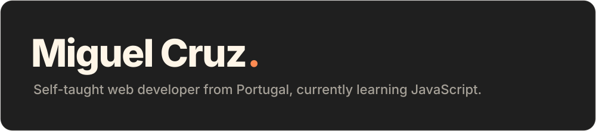
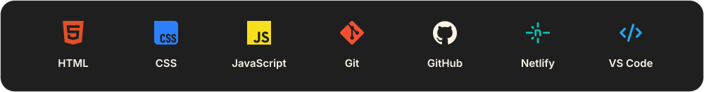

### Right now:

- Working on my JavaScript certification
- Building small JavaScript projects to practise what I learn
- Going back to old projects and fixing what I missed

### Next:

### Tools I use:

 

  

